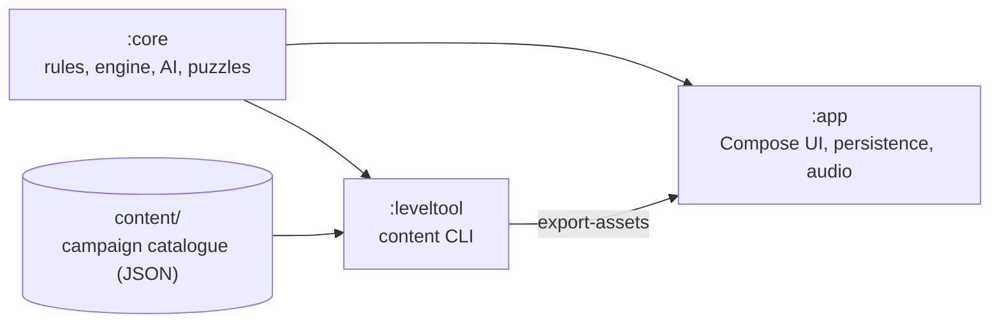

**English** · [Português (Portugal)](README.pt-PT.md)

<div align="center">


# Night Fleet

**An offline naval battle for Android: twelve seas, 600 missions, puzzles and twelve admirals. No ads, no internet.**

[](LICENSE)
[](https://github.com/SyscallBrain/night-fleet/actions/workflows/ci.yml)
[](https://github.com/SyscallBrain/night-fleet/releases/latest)


<br>


[Download](#download) · [Features](#features) · [Screenshots](#screenshots) · [Build](#building-from-source) · [Architecture](#architecture) · [Contributing](#contributing)

</div>

---

## About

Night Fleet is a naval battle game for one player against admirals, or for two players on one device. You place your fleet on a grid, fire at the enemy's water and hunt its ships. It is the fifth title in a series of offline puzzle and arcade games by the same author.

The campaign has **12 seas with 50 missions each** (600 missions in all), every mission in three difficulties: Easy, Medium and Hard. Each sea ends with a boss battle against one of the **12 admirals**, who has their own style.

## Download

- **GitHub:** the signed APK of each version is on the [releases page](https://github.com/SyscallBrain/night-fleet/releases/latest). It is built from the tagged source by the release workflow, and the build is reproducible.
- **F-Droid:** submitted for inclusion; the link will be added here once it is published.

The app needs Android 8.0 or newer and asks only for the vibration permission.

## Features

- **Campaign:** duels, hunts, convoys, lighthouse puzzles and boss battles across the twelve seas, with stars, ranks, a logbook and achievements.
- **Admirals:** rivals with their own style. The AI is fair and deterministic: it never sees your fleet, and the same position always gets the same answer.
- **Lighthouse puzzles:** logic grids with row and column numbers. Each puzzle is generated and checked by a solver, so it has exactly one solution and is solved by reasoning, never by guessing.
- **Rules:** classic 10×10 boards, grids from 8×8 to 12×12, islands and reefs, salvo shots, school rules with seaplanes, submarines that dive, fog, moving ships and minefields. Rule sets can be combined in free play.
- **Six special weapons:** sonar, torpedo, air reconnaissance, cross barrage, decoy and repair. They recharge by sinking enemy ships and are never bought.
- **Daily challenge:** a new puzzle and a new hunt every day, in each difficulty, with the last 14 days in view.
- **Two-player duel:** two players on one device, with a privacy curtain between turns.
- **Free play:** an empty sea or any admiral, with the grid size, difficulty and rules you choose.
- **Endless puzzles:** puzzles with no end, from 6×6 to 10×10.
- **Patrol:** one shared reserve of shots, sea after sea.
- **Admirals' tournament:** a series of duels against the admirals you have already defeated; one lost duel ends it.
- **Logbook, statistics and achievements:** every battle is recorded and can be replayed and analysed; achievements are unlocked by play.
- **Look and feel:** four visual themes (Chart, Sonar, Paper Fleet and Holo Tactical) that can be switched at any time in Settings, and colour-blind palettes (deuteranopia, protanopia, tritanopia) with marks that use shape as well as colour.
- **Accessibility:** TalkBack labels for every square and result, reduced motion, larger text and an option to confirm each shot.
- **Backup:** export and import your progress yourself, from Settings.
- **Languages:** English and European Portuguese, switchable in the app.

## Privacy

Night Fleet is designed to collect nothing:

- **No internet permission.** The app cannot send data anywhere.
- **Only one permission:** `VIBRATE`, for impact feedback.
- No ads, accounts, analytics, third-party SDKs, Google Play Services or purchases.
- Progress stays on the device. You can export a backup and import it yourself.

## Architecture



### Modules

| Module | Contents | Platform |
|---|---|---|
| `:core` | Grid and terrain, fleets and placement rules, the battle engine, weapons, rule sets, the AI admirals, the lighthouse puzzle model and solver, content models, observation and hashing | Pure Kotlin/JVM, no Android |
| `:leveltool` | Command-line tool that generates, calibrates, seals, validates and exports the campaign content | JVM |
| `:app` | Compose screens, the four themes, navigation, persistence, backup, sound and music, haptics | Android 8.0 (API 26) and newer |

The campaign content lives in `content/` and is produced by `:leveltool`. The app reads an exported copy of it at build time. Game logic is tested on the JVM, so no emulator is needed.

## Building from source

### Requirements

| Tool | Version |
|---|---|
| JDK | 17 or newer (CI uses 17) |
| Android SDK | Platform 37 (`compileSdk` 37.2) and build tools |
| Gradle | Wrapper included (9.8.0) |

Kotlin 2.4, Android Gradle Plugin 9.4 and Jetpack Compose (Material 3) are declared in `gradle/libs.versions.toml`.

### Build and install

Gradle always runs through `tools/gw.sh`, a thin wrapper around `./gradlew` that uses `JAVA_HOME` and `ANDROID_HOME` from the environment and limits the number of parallel builds.

```bash
export JAVA_HOME=/path/to/jdk-17          # any JDK 17+
export ANDROID_HOME=/path/to/android-sdk  # or create local.properties with sdk.dir=...

tools/gw.sh :app:assembleDebug
adb install app/build/outputs/apk/debug/app-debug.apk
```

`tools/gw.sh :app:assembleRelease` builds a release APK, unsigned unless you provide signing credentials. To sign it, set `SIGNING_KEYSTORE_FILE`, `SIGNING_PASSWORD` and `SIGNING_KEY_ALIAS` in the environment, or the `nightFleet.release.storeFile`, `nightFleet.release.storePassword` and `nightFleet.release.keyAlias` properties (plus `nightFleet.release.keyPassword` if it differs) in your own `~/.gradle/gradle.properties`. Never commit signing material.

### Verification

```bash
bash tools/verify.sh          # unit tests, lint, debug build, manifest permissions and dependency policy
bash tools/repro_check.sh     # builds two clean clones of HEAD and compares the unsigned release APKs
```

`tools/verify.sh` runs each step, keeps its log in `logs/` and exits with the exit code of the first failing step. Its permission check (`tools/check_permissions.sh`) fails unless `VIBRATE` is the only permission, and its dependency check (`tools/check_deps.sh`) fails on any Google, Firebase or advertising group.

### Reproducible build

The release APK is built without signing credentials and without build-time dates, git revisions or machine paths, so the same commit gives the same bytes. `tools/repro_check.sh` checks this by building two clean clones and printing `REPRODUCIBLE` when the APKs are identical. F-Droid builds the app from source in the same way.

### Campaign content

The campaign is built with `:leveltool`. The per-sea pipeline is:

```bash
tools/content_pipeline.sh --sea 1 --output content      # generate -> calibrate -> seal -> validate -> report
```

The individual steps run through the same tool:

```bash
tools/gw.sh :leveltool:run --args="generate --sea 1 --output content"
tools/gw.sh :leveltool:run --args="calibrate --root content --sea 1 --games 64 --threads 2 --resume"
tools/gw.sh :leveltool:run --args="seal --root content"
tools/gw.sh :leveltool:run --args="validate --root content"        # add --strict for the full campaign
tools/gw.sh :leveltool:run --args="export-assets --root content --output app/build/generated/fleetAssets"
tools/gw.sh :leveltool:run --args="report --root content --output report.md"
```

Exit codes: `0` success, `1` content or verification failed, `2` incorrect usage. Calibration plays simulated human players against each variant, so the difficulty bands are measured rather than guessed.

## Contributing

Bug reports, translations, accessibility feedback and pull requests are welcome. See [CONTRIBUTING.md](CONTRIBUTING.md).

## Screenshots

These are real captures from a phone set to Portuguese, so the game text is in European Portuguese. The app follows the system language: on a phone in English (or any other language) it shows in English, and the language can also be chosen in Settings.

<p align="center">
  
  
  
  
  
  
  
  
  
  
</p>

## Licence and credits

- Code: [MIT License](LICENSE), Copyright (c) 2026 Tiago Correia.
- Sounds and music: generated by the scripts in `tools/` (`generate_sounds.py`, `generate_music.py`) and released under the same MIT licence.
- Fonts: IM FELL English SC (Igino Marini), Chakra Petch, Fredoka, Oxanium, IBM Plex Mono and Figtree, all under the SIL Open Font License 1.1. The licence texts are in [`app/src/main/assets/licenses/`](app/src/main/assets/licenses) and the sources are listed in [`docs/ASSETS.md`](docs/ASSETS.md).
- Launcher icon and store graphics: drawn for this project and generated by [`tools/render_icon.py`](tools/render_icon.py).
- Author: Tiago Correia ([SyscallBrain](https://github.com/SyscallBrain)).
