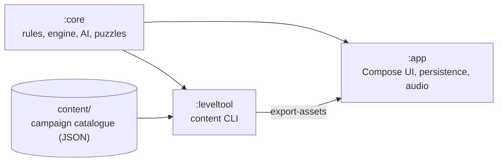

**English** · [Português (Portugal)](README.pt-PT.md)

<div align="center">


# Night Fleet

**An offline naval battle for Android: twelve seas, 600 missions, puzzles and twelve admirals. No ads, no internet.**

[](https://github.com/SyscallBrain/night-fleet/actions/workflows/ci.yml)
[](https://github.com/SyscallBrain/night-fleet/releases/latest)
[](LICENSE)


<br>


[Screenshots](#screenshots) · [Download](#download) · [Features](#features) · [How to play](#how-to-play) · [Fair by design](#fair-by-design) · [Build](#building-from-source) · [Architecture](#architecture)

</div>

---

## About

Night Fleet is a naval battle game for one player against AI admirals, or for two players on one phone. You place your fleet, fire into the enemy's water and hunt down its ships, square by square.

The campaign crosses **12 seas of 50 missions** (600 in all), each in Easy, Medium and Hard. Every sea has its own weather, its own rules and an admiral waiting at the end. Between the duels there are hunts with a limited number of shots, convoy escorts and lighthouse logic puzzles. It plays fully offline, asks for nothing, and never shows an ad.

## Screenshots

<table>
  <tr>
    <td align="center" width="20%"><br><sub>Home</sub></td>
    <td align="center" width="20%"><br><sub>Sea map</sub></td>
    <td align="center" width="20%"><br><sub>Fleet placement</sub></td>
    <td align="center" width="20%"><br><sub>Campaign battle</sub></td>
    <td align="center" width="20%"><br><sub>12×12 with weapons</sub></td>
  </tr>
  <tr>
    <td align="center"><br><sub>New rules, explained</sub></td>
    <td align="center"><br><sub>Daily challenge</sub></td>
    <td align="center"><br><sub>Patrol</sub></td>
    <td align="center"><br><sub>Four themes</sub></td>
    <td align="center"><br><sub>Achievements</sub></td>
  </tr>
</table>

<sub>Captured on a phone set to Portuguese. The app follows the system language, so on a phone in English it is in English; the language can also be changed in Settings.</sub>

## Download

<a href="https://github.com/SyscallBrain/night-fleet/releases/latest"></a>

- **GitHub releases:** the signed APK of each version. It is built from the tagged source by the [release workflow](.github/workflows/release.yml), and the build is reproducible.
- **F-Droid:** submitted for inclusion. The link will be added here once it is published.

Night Fleet needs Android 8.0 or newer. To check that an APK is genuine, compare its signing certificate with this SHA-256 fingerprint (for example with `apksigner verify --print-certs`):

```
2b:19:8b:43:d2:e1:b6:cf:7b:95:a5:7d:b5:8c:3f:51:5b:45:36:21:b7:94:aa:6b:ca:5a:0c:bd:6d:40:56:62
```

## Features

### Campaign

- **12 seas, 600 missions, 3 difficulties.** Stars for every mission, ranks to climb and a logbook of every battle.
- **12 admirals,** each with a style of play and a boss duel that closes their sea.
- **Varied missions:** duels, hunts with a shot budget, convoy escorts and lighthouse puzzles.
- **New rules arrive gradually,** each introduced with a short explanation the first time it appears.

### Game modes

| Mode | What it is |
|---|---|
| Daily challenge | A new puzzle and a new hunt every day, in each difficulty, with the last 14 days in view |
| Free play | Any admiral or an empty sea, with the grid, difficulty, rules and weapons you choose |
| Two-player duel | Two players on one phone, with a privacy curtain between turns |
| Endless puzzles | Lighthouse puzzles from 6×6 to 10×10, generated on the spot |
| Patrol | One shared reserve of shots, sea after sea, for as long as it lasts |
| Admirals' tournament | Eight duels in a row against admirals you have beaten; one defeat ends the run |

### Rules and weapons

- Grids from **8×8 to 12×12**, islands and reefs, salvo fire, school rules with seaplanes, submarines that dive, fog of war, ships that move and minefields. In free play they can be combined freely.
- **Six special weapons:** sonar, torpedo, air reconnaissance, cross barrage, decoy and repair. They recharge during the battle and are never bought.

### Comfort and accessibility

- **Four visual themes:** Nautical Chart, Abyssal Sonar, Paper Fleet and Holo Tactical, with weather on each sea.
- **Colour-blind palettes** (deuteranopia, protanopia, tritanopia), with marks that differ in shape as well as colour, and a high-contrast grid.
- **TalkBack** reads every square and result; larger text, reduced motion, a left-handed layout and an option to confirm each shot.
- **Statistics and achievements:** precision, streaks, a heat map of your shots, ships sunk and weapons used, per difficulty.
- **Backup:** export and import your progress yourself, from Settings.
- **English and European Portuguese,** switchable in the app.

## How to play

1. **Place your fleet.** Pick a ship from the dock and tap a square to place it; tap it again to rotate it, or let Automatic place the whole fleet.
2. **Fire.** Tap a square of the enemy's sea. Water is marked, a hit shows on the ship, and a sunk ship is revealed whole.
3. **Use your weapons.** Pick one from the strip under the board; the line under it explains what it does and how it recharges.
4. **Win with fewer shots** for more stars. A hint is there when you are stuck, but a battle won with a hint earns at most two stars.
5. **Solve the lighthouse puzzles.** The numbers on each row and column count the ship squares in it; mark water and ships until the fleet fits.

## Fair by design

- **The admirals never cheat.** The AI plays only from its own shots and what they revealed; it never looks at your fleet. The engine is deterministic, so the same position always gets the same answer.
- **Every mission is proven.** Each campaign variant ships with a certificate: a replayable winning game, or for puzzles a solver proof. The build replays all of them with the game engine, so no impossible mission reaches the player.
- **Difficulty is measured, not guessed.** Each variant was calibrated by having simulated players play it many times against its admiral. Nearly all of the 1,800 variants land in the win-rate band of their difficulty, and the few that do not are flagged in their certificates.
- **Puzzles have exactly one solution,** checked by an exact solver, so they are solved by reasoning, never by guessing.

## Privacy

Night Fleet is designed to collect nothing:

- **No internet permission.** The app cannot send data anywhere.
- **Only one permission:** `VIBRATE`, for impact feedback.
- No ads, accounts, analytics, third-party SDKs, Google Play Services or purchases.
- Progress stays on the device. You can export a backup and import it yourself.

## Building from source

### Requirements

| Tool | Version |
|---|---|
| JDK | 17 or newer (releases are built with 21) |
| Android SDK | Platform 37 (`compileSdk` 37.2) and build tools |
| Gradle | Wrapper included (9.8.0) |

Kotlin 2.4, Android Gradle Plugin 9.4 and Jetpack Compose (Material 3) are declared in `gradle/libs.versions.toml`.

### Build and install

Gradle runs through `tools/gw.sh`, a thin wrapper around `./gradlew` that takes `JAVA_HOME` and `ANDROID_HOME` from the environment and limits the number of parallel builds.

```bash
export JAVA_HOME=/path/to/jdk-21          # any JDK 17+
export ANDROID_HOME=/path/to/android-sdk  # or create local.properties with sdk.dir=...

tools/gw.sh :app:assembleDebug
adb install app/build/outputs/apk/debug/app-debug.apk
```

`tools/gw.sh :app:assembleRelease` builds a release APK, unsigned unless you provide signing credentials. To sign it, set `SIGNING_KEYSTORE_FILE`, `SIGNING_PASSWORD` and `SIGNING_KEY_ALIAS` in the environment, or the `nightFleet.release.storeFile`, `nightFleet.release.storePassword` and `nightFleet.release.keyAlias` properties (plus `nightFleet.release.keyPassword` if it differs) in your own `~/.gradle/gradle.properties`. Never commit signing material.

### Verification

```bash
bash tools/verify.sh          # unit tests, lint, debug build, manifest permissions and dependency policy
bash tools/repro_check.sh     # builds two clean clones of HEAD and compares the unsigned release APKs
```

`tools/verify.sh` runs each step, keeps its log in `logs/` and exits with the exit code of the first failing step. Its permission check (`tools/check_permissions.sh`) fails unless `VIBRATE` is the only permission, and its dependency check (`tools/check_deps.sh`) fails on any Google, Firebase or advertising group.

### Reproducible build

The release APK is built without build-time dates, git revisions or machine paths, so the same commit gives the same bytes. `tools/repro_check.sh` checks this by building two clean clones and printing `REPRODUCIBLE` when the APKs are identical, and the CI runs the same check on every push. F-Droid builds the app from source and compares it with the signed release.

### Campaign content

The campaign is built with `:leveltool`. The per-sea pipeline is:

```bash
tools/content_pipeline.sh --sea 1 --output content      # generate -> calibrate -> seal -> validate -> report
```

The individual steps run through the same tool:

```bash
tools/gw.sh :leveltool:run --args="generate --sea 1 --output content"
tools/gw.sh :leveltool:run --args="calibrate --root content --sea 1 --games 64 --threads 2 --resume"
tools/gw.sh :leveltool:run --args="seal --root content"
tools/gw.sh :leveltool:run --args="validate --root content"        # add --strict for the full campaign
tools/gw.sh :leveltool:run --args="export-assets --root content --output app/build/generated/fleetAssets"
tools/gw.sh :leveltool:run --args="report --root content --output report.md"
```

Exit codes: `0` success, `1` content or verification failed, `2` incorrect usage.

## Architecture



| Module | Contents | Platform |
|---|---|---|
| `:core` | Grid and terrain, fleets and placement rules, the battle engine, weapons, rule sets, the AI admirals, the lighthouse puzzle model and solver, content models, observation and hashing | Pure Kotlin/JVM, no Android |
| `:leveltool` | Command-line tool that generates, calibrates, seals, validates and exports the campaign content | JVM |
| `:app` | Compose screens, the four themes, navigation, persistence, backup, sound and music, haptics | Android 8.0 (API 26) and newer |

The campaign content lives in `content/` and is produced by `:leveltool`. The app reads an exported copy of it at build time. Game logic is tested on the JVM, so no emulator is needed.

## Contributing

Bug reports, translations, accessibility feedback and pull requests are welcome. See [CONTRIBUTING.md](CONTRIBUTING.md).

## Licence and credits

- **Code:** [MIT License](LICENSE), Copyright (c) 2026 Tiago Correia.
- **Sounds and music:** generated by the scripts in `tools/` (`generate_sounds.py`, `generate_music.py`) and released under the same MIT licence.
- **Fonts:** IM FELL English SC (Igino Marini), Chakra Petch, Fredoka, Oxanium, IBM Plex Mono and Figtree, all under the SIL Open Font License 1.1. The licence texts are in [`app/src/main/assets/licenses/`](app/src/main/assets/licenses) and the sources are listed in [`docs/ASSETS.md`](docs/ASSETS.md).
- **Launcher icon and store graphics:** drawn for this project and generated by [`tools/render_icon.py`](tools/render_icon.py).

Night Fleet is an independent game and is not affiliated with any board-game publisher.

<div align="center">

Made by Tiago Correia ([SyscallBrain](https://github.com/SyscallBrain)) · also by the same author: [Bubble Night](https://github.com/SyscallBrain/bubble-night) · [Block Night](https://github.com/SyscallBrain/block-night)

</div>
