[English](README.md) · **Português (Portugal)**

<div align="center">

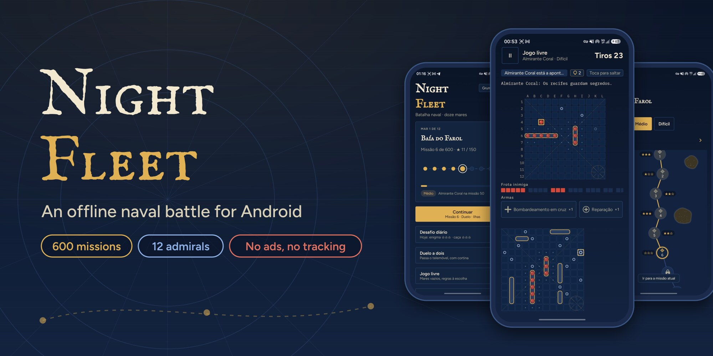

# Night Fleet

**Uma batalha naval offline para Android: doze mares, 600 missões, enigmas e doze almirantes. Sem anúncios, sem internet.**

[](https://github.com/SyscallBrain/night-fleet/actions/workflows/ci.yml)
[](https://github.com/SyscallBrain/night-fleet/releases/latest)
[](LICENSE)


<br>


[Capturas](#capturas-de-ecrã) · [Descarregar](#descarregar) · [Funcionalidades](#funcionalidades) · [Como jogar](#como-jogar) · [Jogo justo](#jogo-justo) · [Compilar](#compilar-a-partir-do-código) · [Arquitetura](#arquitetura)

</div>

---

## Sobre

O Night Fleet é uma batalha naval para um jogador contra almirantes controlados pelo computador, ou para dois jogadores no mesmo telemóvel. Colocas a tua frota, disparas sobre o mar inimigo e caças os navios dele, casa a casa.

A campanha atravessa **12 mares de 50 missões** (600 no total), cada uma em Fácil, Médio e Difícil. Cada mar tem o seu tempo, regras novas e um almirante à espera no fim. Entre os duelos há caças com um número limitado de tiros, escoltas de comboios e enigmas lógicos do farol. Joga-se totalmente offline, não pede nada e nunca mostra anúncios.

## Capturas de ecrã

<table>
  <tr>
    <td align="center" width="20%">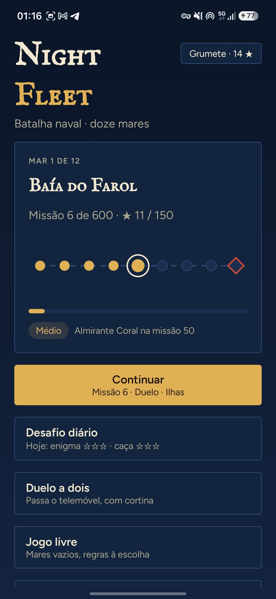<br><sub>Início</sub></td>
    <td align="center" width="20%">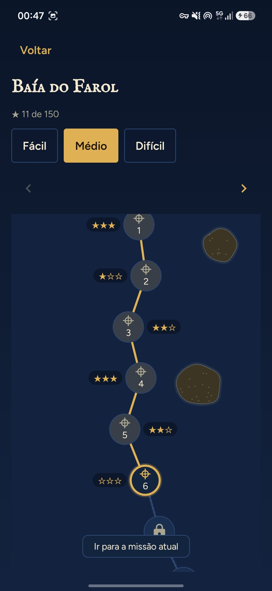<br><sub>Mapa do mar</sub></td>
    <td align="center" width="20%">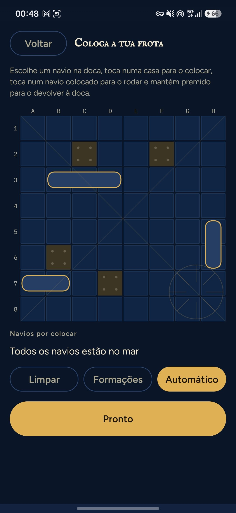<br><sub>Colocação da frota</sub></td>
    <td align="center" width="20%">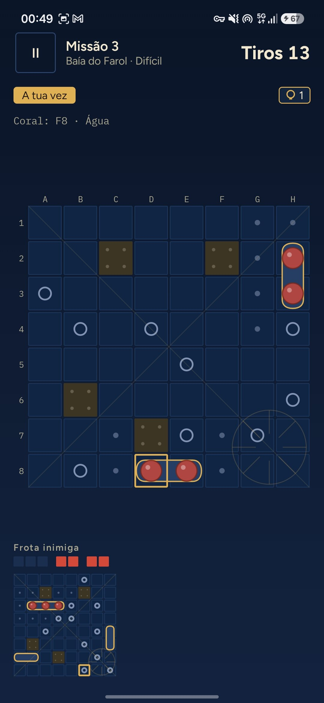<br><sub>Batalha da campanha</sub></td>
    <td align="center" width="20%">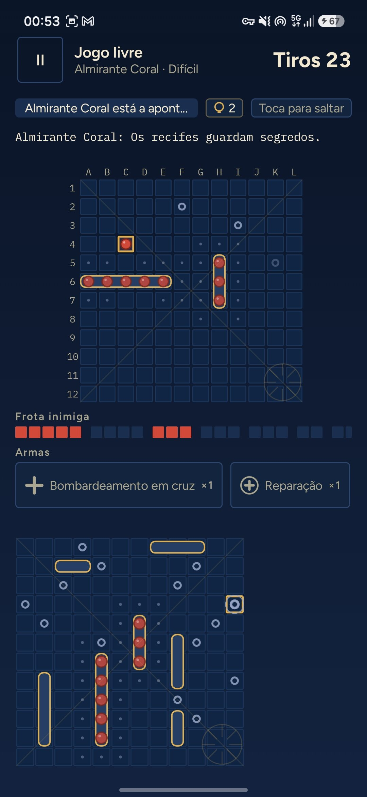<br><sub>12×12 com armas</sub></td>
  </tr>
  <tr>
    <td align="center">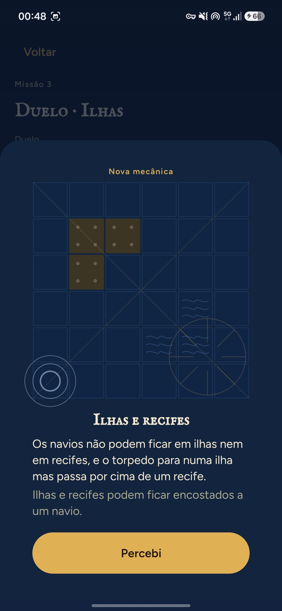<br><sub>Regras novas, explicadas</sub></td>
    <td align="center">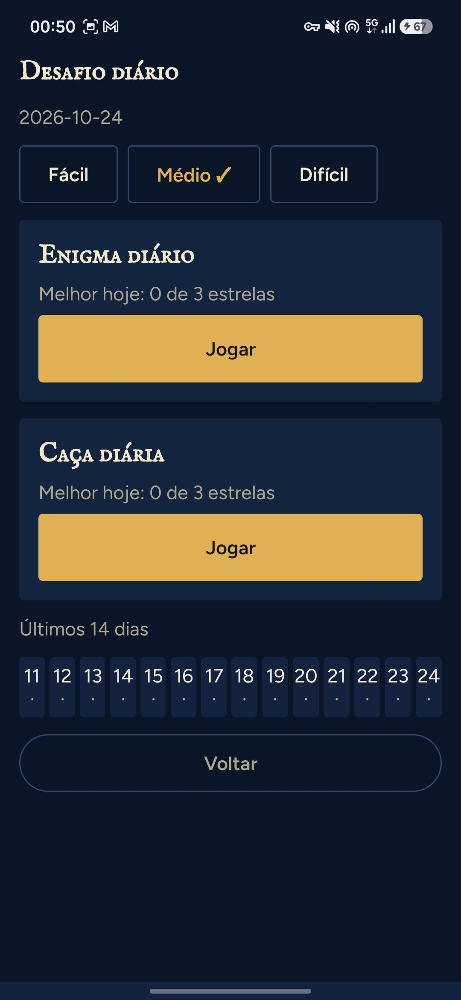<br><sub>Desafio diário</sub></td>
    <td align="center">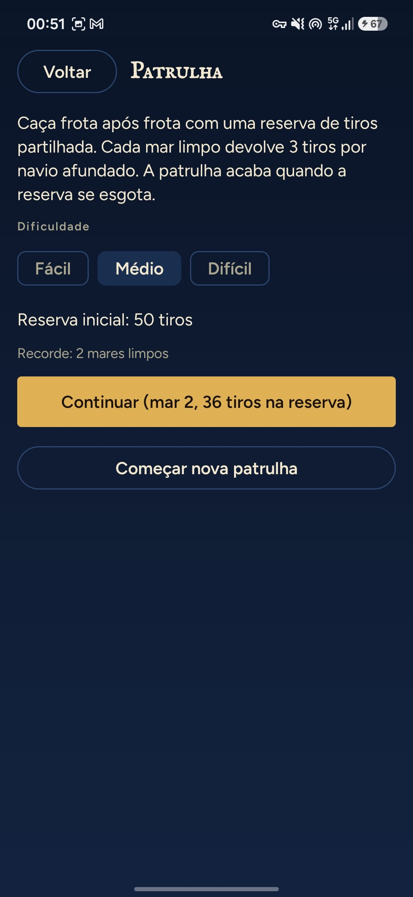<br><sub>Patrulha</sub></td>
    <td align="center">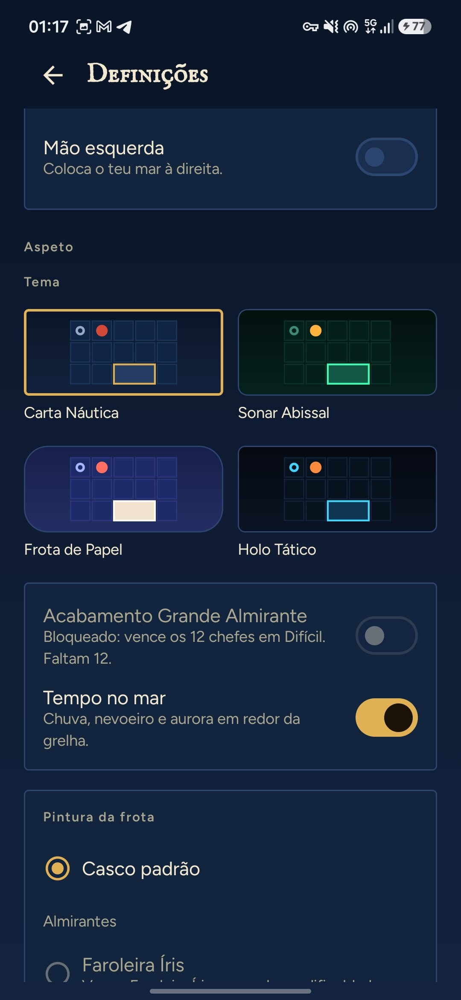<br><sub>Quatro temas</sub></td>
    <td align="center">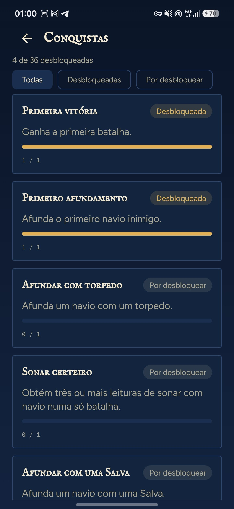<br><sub>Conquistas</sub></td>
  </tr>
</table>

<sub>Capturas de um telemóvel em português. A app segue a língua do sistema, por isso num telemóvel em inglês aparece em inglês; a língua também se pode mudar nas Definições.</sub>

## Descarregar

<a href="https://github.com/SyscallBrain/night-fleet/releases/latest"></a>

- **Versões no GitHub:** o APK assinado de cada versão. É compilado a partir do código da tag pelo [workflow de release](.github/workflows/release.yml), e a build é reprodutível.
- **F-Droid:** submetido para inclusão. A ligação fica aqui quando for publicado.

O Night Fleet precisa do Android 8.0 ou mais recente. Para confirmar que um APK é genuíno, compara o certificado de assinatura com esta impressão digital SHA-256 (por exemplo com `apksigner verify --print-certs`):

```
2b:19:8b:43:d2:e1:b6:cf:7b:95:a5:7d:b5:8c:3f:51:5b:45:36:21:b7:94:aa:6b:ca:5a:0c:bd:6d:40:56:62
```

## Funcionalidades

### Campanha

- **12 mares, 600 missões, 3 dificuldades.** Estrelas em cada missão, patentes para subir e um diário de bordo com todas as batalhas.
- **12 almirantes,** cada um com o seu estilo de jogo e um duelo de chefe que fecha o seu mar.
- **Missões variadas:** duelos, caças com um orçamento de tiros, escoltas de comboios e enigmas do farol.
- **As regras novas chegam aos poucos,** cada uma apresentada com uma explicação curta na primeira vez que aparece.

### Modos de jogo

| Modo | O que é |
|---|---|
| Desafio diário | Um enigma e uma caça novos todos os dias, em cada dificuldade, com os últimos 14 dias à vista |
| Jogo livre | Qualquer almirante ou um mar vazio, com a grelha, a dificuldade, as regras e as armas que escolheres |
| Duelo a dois | Dois jogadores no mesmo telemóvel, com uma cortina entre os turnos |
| Enigmas sem fim | Enigmas do farol de 6×6 a 10×10, gerados na hora |
| Patrulha | Uma reserva de tiros partilhada, mar após mar, enquanto durar |
| Torneio dos almirantes | Oito duelos seguidos contra almirantes que já venceste; uma derrota acaba o torneio |

### Regras e armas

- Grelhas de **8×8 a 12×12**, ilhas e recifes, salvas, regras da escola com hidroaviões, submarinos que mergulham, nevoeiro de guerra, navios que se movem e campos de minas. No jogo livre combinam-se à vontade.
- **Seis armas especiais:** sonar, torpedo, reconhecimento aéreo, bombardeamento em cruz, isco e reparação. Recarregam durante a batalha e nunca se compram.

### Conforto e acessibilidade

- **Quatro temas visuais:** Carta Náutica, Sonar Abissal, Frota de Papel e Holo Tático, com o tempo de cada mar.
- **Paletas para daltonismo** (deuteranopia, protanopia, tritanopia), com marcas que diferem na forma e não só na cor, e uma grelha de alto contraste.
- O **TalkBack** lê cada casa e cada resultado; texto maior, movimento reduzido, modo para canhotos e opção de confirmar cada tiro.
- **Estatísticas e conquistas:** precisão, sequências, mapa de calor dos teus tiros, navios afundados e armas usadas, por dificuldade.
- **Cópia de segurança:** exportas e importas o teu progresso tu próprio, nas Definições.
- **Inglês e português europeu,** com troca dentro da app.

## Como jogar

1. **Coloca a tua frota.** Escolhe um navio na doca e toca numa casa para o colocar; toca-lhe outra vez para o rodar, ou deixa o Automático colocar a frota toda.
2. **Dispara.** Toca numa casa do mar inimigo. A água fica marcada, um acerto aparece no navio e um navio afundado revela-se inteiro.
3. **Usa as armas.** Escolhe uma na faixa por baixo do tabuleiro; a linha por baixo dela explica o que faz e como recarrega.
4. **Ganha com menos tiros** para teres mais estrelas. Há uma dica quando estás encalhado, mas uma batalha ganha com dica dá no máximo duas estrelas.
5. **Resolve os enigmas do farol.** Os números de cada linha e coluna contam as casas de navio que lá estão; marca água e navios até a frota encaixar.

## Jogo justo

- **Os almirantes nunca fazem batota.** O computador joga só a partir dos seus próprios tiros e do que eles revelaram; nunca olha para a tua frota. O motor é determinista, por isso a mesma posição tem sempre a mesma resposta.
- **Todas as missões estão provadas.** Cada variante da campanha traz um certificado: um jogo vencedor que se pode repetir ou, nos enigmas, uma prova do solucionador. A build repete-os todos com o motor do jogo, por isso nenhuma missão impossível chega ao jogador.
- **A dificuldade é medida, não adivinhada.** Cada variante foi calibrada pondo jogadores simulados a jogá-la muitas vezes contra o seu almirante. Quase todas as 1800 variantes ficam na faixa de vitórias da sua dificuldade, e as poucas exceções estão assinaladas nos certificados.
- **Os enigmas têm uma só solução,** confirmada por um solucionador exato, por isso resolvem-se por raciocínio e nunca à sorte.

## Privacidade

O Night Fleet foi desenhado para não recolher nada:

- **Sem permissão de internet.** A app não consegue enviar dados para lado nenhum.
- **Só uma permissão:** `VIBRATE`, para o feedback dos impactos.
- Sem anúncios, contas, análises de utilização, SDKs de terceiros, Google Play Services nem compras.
- O progresso fica no telemóvel. Podes exportar uma cópia de segurança e importá-la tu próprio.

## Compilar a partir do código

### Requisitos

| Ferramenta | Versão |
|---|---|
| JDK | 17 ou superior (as versões publicadas usam o 21) |
| SDK do Android | Plataforma 37 (`compileSdk` 37.2) e build tools |
| Gradle | Wrapper incluído (9.8.0) |

Kotlin 2.4, Android Gradle Plugin 9.4 e Jetpack Compose (Material 3) estão declarados em `gradle/libs.versions.toml`.

### Compilar e instalar

O Gradle corre através de `tools/gw.sh`, um invólucro fino à volta de `./gradlew` que usa o `JAVA_HOME` e o `ANDROID_HOME` do ambiente e limita o número de builds em paralelo.

```bash
export JAVA_HOME=/caminho/para/jdk-21          # qualquer JDK 17+
export ANDROID_HOME=/caminho/para/android-sdk  # ou cria local.properties com sdk.dir=...

tools/gw.sh :app:assembleDebug
adb install app/build/outputs/apk/debug/app-debug.apk
```

`tools/gw.sh :app:assembleRelease` compila um APK de lançamento, sem assinatura, a não ser que forneças as credenciais de assinatura. Para o assinar, define `SIGNING_KEYSTORE_FILE`, `SIGNING_PASSWORD` e `SIGNING_KEY_ALIAS` no ambiente, ou as propriedades `nightFleet.release.storeFile`, `nightFleet.release.storePassword` e `nightFleet.release.keyAlias` (e `nightFleet.release.keyPassword`, se for diferente) no teu `~/.gradle/gradle.properties`. Nunca publiques material de assinatura.

### Verificação

```bash
bash tools/verify.sh          # testes unitários, lint, APK de depuração, permissões e política de dependências
bash tools/repro_check.sh     # compila dois clones limpos do HEAD e compara os APK de lançamento sem assinatura
```

O `tools/verify.sh` corre cada passo, guarda o registo em `logs/` e termina com o código de saída do primeiro passo que falhar. A verificação de permissões (`tools/check_permissions.sh`) falha se `VIBRATE` não for a única permissão, e a de dependências (`tools/check_deps.sh`) falha com qualquer grupo da Google, do Firebase ou de publicidade.

### Compilação reprodutível

O APK de lançamento compila-se sem datas, revisões do git ou caminhos da máquina, por isso o mesmo commit dá os mesmos bytes. O `tools/repro_check.sh` verifica isto: compila dois clones limpos e imprime `REPRODUCIBLE` quando os APK são idênticos, e a CI faz a mesma verificação em cada push. O F-Droid compila a app a partir do código e compara-a com a versão assinada.

### Conteúdo da campanha

A campanha constrói-se com o `:leveltool`. O pipeline de um mar é:

```bash
tools/content_pipeline.sh --sea 1 --output content      # gerar -> calibrar -> selar -> validar -> relatório
```

Os passos individuais correm pela mesma ferramenta:

```bash
tools/gw.sh :leveltool:run --args="generate --sea 1 --output content"
tools/gw.sh :leveltool:run --args="calibrate --root content --sea 1 --games 64 --threads 2 --resume"
tools/gw.sh :leveltool:run --args="seal --root content"
tools/gw.sh :leveltool:run --args="validate --root content"        # acrescenta --strict para a campanha completa
tools/gw.sh :leveltool:run --args="export-assets --root content --output app/build/generated/fleetAssets"
tools/gw.sh :leveltool:run --args="report --root content --output report.md"
```

Códigos de saída: `0` sucesso, `1` conteúdo ou verificação falhada, `2` utilização incorreta.

## Arquitetura

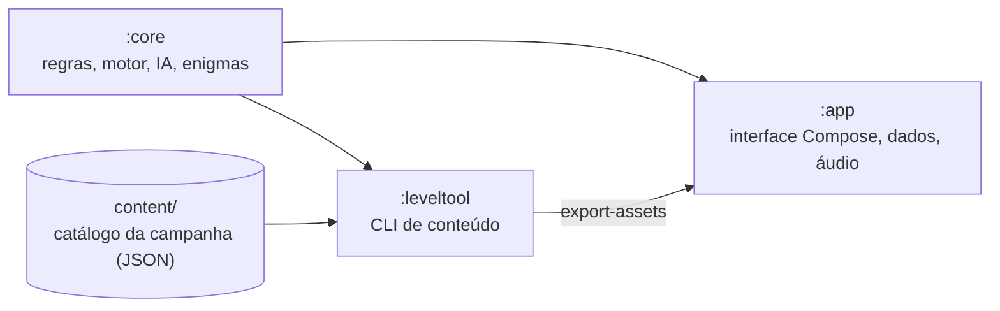

| Módulo | Conteúdo | Plataforma |
|---|---|---|
| `:core` | Grelha e terreno, frotas e regras de colocação, motor de batalha, armas, conjuntos de regras, almirantes (IA), modelo e solucionador dos enigmas do farol, modelos de conteúdo, observação e hashes | Kotlin/JVM puro, sem Android |
| `:leveltool` | Ferramenta de linha de comandos que gera, calibra, sela, valida e exporta o conteúdo da campanha | JVM |
| `:app` | Ecrãs Compose, os quatro temas, navegação, persistência, cópias de segurança, som, música e vibração | Android 8.0 (API 26) e superior |

O conteúdo da campanha vive em `content/` e é produzido pelo `:leveltool`. A app lê uma cópia exportada dele durante a build. A lógica do jogo testa-se na JVM, por isso não é preciso emulador.

## Contribuir

Relatórios de erros, traduções, comentários sobre acessibilidade e pedidos de integração são bem-vindos. Ver [CONTRIBUTING.md](CONTRIBUTING.md).

## Licença e créditos

- **Código:** [licença MIT](LICENSE), Copyright (c) 2026 Tiago Correia.
- **Sons e música:** gerados pelos scripts de `tools/` (`generate_sounds.py`, `generate_music.py`) e publicados com a mesma licença MIT.
- **Tipos de letra:** IM FELL English SC (Igino Marini), Chakra Petch, Fredoka, Oxanium, IBM Plex Mono e Figtree, todos sob a licença SIL Open Font 1.1. Os textos das licenças estão em [`app/src/main/assets/licenses/`](app/src/main/assets/licenses) e as origens estão listadas em [`docs/ASSETS.md`](docs/ASSETS.md).
- **Ícone e imagens da loja:** desenhados para este projeto e gerados por [`tools/render_icon.py`](tools/render_icon.py).

O Night Fleet é um jogo independente e não tem ligação a nenhuma editora de jogos de tabuleiro.

<div align="center">

Feito por Tiago Correia ([SyscallBrain](https://github.com/SyscallBrain)) · do mesmo autor: [Bubble Night](https://github.com/SyscallBrain/bubble-night) · [Block Night](https://github.com/SyscallBrain/block-night)

</div>
