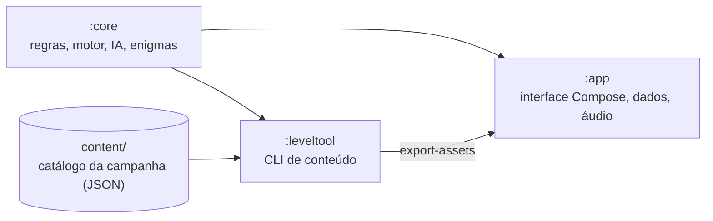

[English](README.md) · **Português (Portugal)**

<div align="center">


# Night Fleet

**Uma batalha naval offline para Android: doze mares, 600 missões, enigmas e doze almirantes. Sem anúncios, sem internet.**

[](LICENSE)
[](https://github.com/SyscallBrain/night-fleet/actions/workflows/ci.yml)
[](https://github.com/SyscallBrain/night-fleet/releases/latest)


<br>


[Descarregar](#descarregar) · [Funcionalidades](#funcionalidades) · [Capturas](#capturas-de-ecrã) · [Compilar](#compilar-a-partir-do-código) · [Arquitetura](#arquitetura) · [Contribuir](#contribuir)

</div>

---

## Sobre

O Night Fleet é um jogo de batalha naval para um jogador contra almirantes, ou para dois jogadores no mesmo telemóvel. Colocas a tua frota numa grelha, disparas sobre a água do adversário e caças os seus navios. É o quinto jogo de uma série de jogos offline de enigmas e ação do mesmo autor.

A campanha tem **12 mares com 50 missões cada** (600 missões no total), cada missão em três dificuldades: Fácil, Médio e Difícil. Cada mar termina com uma batalha contra um chefe, um dos **12 almirantes**, cada um com o seu estilo.

## Descarregar

- **GitHub:** o APK assinado de cada versão está na [página de versões](https://github.com/SyscallBrain/night-fleet/releases/latest). É compilado a partir do código da tag pelo workflow de release, e a build é reproduzível.
- **F-Droid:** submetido para inclusão; a ligação fica aqui quando for publicado.

A app precisa do Android 8.0 ou mais recente e só pede a permissão de vibração.

## Funcionalidades

- **Campanha:** duelos, caças, comboios, enigmas do farol e batalhas contra chefes nos doze mares, com estrelas, patentes, diário de bordo e conquistas.
- **Almirantes:** adversários com estilo próprio. A IA é justa e determinística: nunca vê a tua frota, e a mesma posição dá sempre a mesma resposta.
- **Enigmas do farol:** grelhas de lógica com os números das linhas e das colunas. Cada enigma é gerado e verificado por um solucionador, por isso tem exatamente uma solução e resolve-se por raciocínio, nunca por adivinhação.
- **Regras:** tabuleiros clássicos de 10×10, grelhas de 8×8 a 12×12, ilhas e recifes, salvas, regras da escola com hidroaviões, submarinos que mergulham, nevoeiro, navios que se movem e minas. As regras podem ser combinadas no jogo livre.
- **Seis armas especiais:** sonar, torpedo, reconhecimento aéreo, bombardeamento em cruz, isco e reparação. Carregam-se ao afundar navios inimigos e nunca se compram.
- **Desafio diário:** um enigma novo e uma caça nova todos os dias, em cada dificuldade, com os últimos 14 dias à vista.
- **Duelo a dois:** dois jogadores no mesmo telemóvel, com cortina de privacidade entre os turnos.
- **Jogo livre:** um mar vazio ou qualquer almirante, com a grelha, a dificuldade e as regras que escolheres.
- **Enigmas sem fim:** resolves um enigma a seguir ao outro, sem limite, de 6×6 a 10×10.
- **Patrulha:** uma reserva de tiros partilhada, mar a mar.
- **Torneio dos almirantes:** uma série de duelos contra os almirantes que já venceste; um duelo perdido acaba-o.
- **Diário de bordo, estatísticas e conquistas:** cada batalha fica registada e pode ser repetida e analisada; as conquistas desbloqueiam-se com o jogo.
- **Aspeto:** quatro temas visuais (Carta Náutica, Sonar Abissal, Frota de Papel e Holo Tático) que se mudam a qualquer momento nas Definições, e paletas para daltonismo (deuteranopia, protanopia, tritanopia) com marcas que usam a forma além da cor.
- **Acessibilidade:** descrições para leitores de ecrã em cada casa e em cada resultado, movimento reduzido, texto maior e opção para confirmar cada tiro.
- **Cópia de segurança:** exportas e importas o teu progresso tu próprio, nas Definições.
- **Idiomas:** inglês e português europeu, à escolha na app.

## Privacidade

O Night Fleet foi desenhado para não recolher nada:

- **Sem permissão de internet.** A app não consegue enviar dados para lado nenhum.
- **Só uma permissão:** `VIBRATE`, para o feedback dos impactos.
- Sem anúncios, contas, análises de utilização, SDKs de terceiros, Google Play Services nem compras.
- O progresso fica no telemóvel. Podes exportar uma cópia de segurança e importá-la tu próprio.

## Arquitetura



### Módulos

| Módulo | Conteúdo | Plataforma |
|---|---|---|
| `:core` | Grelha e terreno, frotas e regras de colocação, motor de batalha, armas, conjuntos de regras, almirantes (IA), modelo e solucionador dos enigmas do farol, modelos de conteúdo, observação e hashes | Kotlin/JVM puro, sem Android |
| `:leveltool` | Ferramenta de linha de comandos que gera, calibra, sela, valida e exporta o conteúdo da campanha | JVM |
| `:app` | Ecrãs Compose, os quatro temas, navegação, persistência, cópias de segurança, som, música e vibração | Android 8.0 (API 26) e superior |

O conteúdo da campanha vive em `content/` e é produzido pelo `:leveltool`. A app lê uma cópia exportada dele durante o build. A lógica do jogo testa-se na JVM, por isso não é preciso emulador.

## Compilar a partir do código

### Requisitos

| Ferramenta | Versão |
|---|---|
| JDK | 17 ou superior (a CI usa 17) |
| SDK do Android | Plataforma 37 (`compileSdk` 37.2) e build tools |
| Gradle | Wrapper incluído (9.8.0) |

Kotlin 2.4, Android Gradle Plugin 9.4 e Jetpack Compose (Material 3) estão declarados em `gradle/libs.versions.toml`.

### Compilar e instalar

O Gradle corre sempre através de `tools/gw.sh`, um invólucro fino à volta de `./gradlew` que usa o `JAVA_HOME` e o `ANDROID_HOME` do ambiente e limita o número de builds em paralelo.

```bash
export JAVA_HOME=/caminho/para/jdk-17          # qualquer JDK 17+
export ANDROID_HOME=/caminho/para/android-sdk  # ou cria local.properties com sdk.dir=...

tools/gw.sh :app:assembleDebug
adb install app/build/outputs/apk/debug/app-debug.apk
```

`tools/gw.sh :app:assembleRelease` compila um APK de lançamento, sem assinatura, a não ser que forneças as credenciais de assinatura. Para o assinar, define `SIGNING_KEYSTORE_FILE`, `SIGNING_PASSWORD` e `SIGNING_KEY_ALIAS` no ambiente, ou as propriedades `nightFleet.release.storeFile`, `nightFleet.release.storePassword` e `nightFleet.release.keyAlias` (e `nightFleet.release.keyPassword`, se for diferente) no teu `~/.gradle/gradle.properties`. Nunca publiques material de assinatura.

### Verificação

```bash
bash tools/verify.sh          # testes unitários, lint, APK de depuração, permissões e política de dependências
bash tools/repro_check.sh     # compila dois clones limpos do HEAD e compara os APK de lançamento sem assinatura
```

O `tools/verify.sh` corre cada passo, guarda o registo em `logs/` e termina com o código de saída do primeiro passo que falhar. A verificação de permissões (`tools/check_permissions.sh`) falha se `VIBRATE` não for a única permissão, e a de dependências (`tools/check_deps.sh`) falha com qualquer grupo da Google, do Firebase ou de publicidade.

### Compilação reprodutível

O APK de lançamento compila-se sem credenciais de assinatura e sem datas, revisões do git ou caminhos da máquina na compilação, por isso o mesmo commit dá os mesmos bytes. O `tools/repro_check.sh` verifica isto: compila dois clones limpos e imprime `REPRODUCIBLE` quando os APK são idênticos. O F-Droid compila a app a partir do código da mesma forma.

### Conteúdo da campanha

A campanha constrói-se com o `:leveltool`. O pipeline de um mar é:

```bash
tools/content_pipeline.sh --sea 1 --output content      # gerar -> calibrar -> selar -> validar -> relatório
```

Os passos individuais correm pela mesma ferramenta:

```bash
tools/gw.sh :leveltool:run --args="generate --sea 1 --output content"
tools/gw.sh :leveltool:run --args="calibrate --root content --sea 1 --games 64 --threads 2 --resume"
tools/gw.sh :leveltool:run --args="seal --root content"
tools/gw.sh :leveltool:run --args="validate --root content"        # acrescenta --strict para a campanha completa
tools/gw.sh :leveltool:run --args="export-assets --root content --output app/build/generated/fleetAssets"
tools/gw.sh :leveltool:run --args="report --root content --output report.md"
```

Códigos de saída: `0` sucesso, `1` conteúdo ou verificação falhada, `2` utilização incorreta. A calibração faz jogar jogadores humanos simulados contra cada variante, por isso as faixas de dificuldade são medidas e não adivinhadas.

## Contribuir

Relatórios de erros, traduções, comentários sobre acessibilidade e pedidos de integração são bem-vindos. Ver [CONTRIBUTING.md](CONTRIBUTING.md).

## Capturas de ecrã

São capturas reais de um telemóvel em português, por isso o texto do jogo está em português europeu. A app segue a língua do sistema: num telemóvel em inglês (ou noutra língua) aparece em inglês, e a língua também se pode escolher nas Definições.

<p align="center">
  
  
  
  
  
  
  
  
  
  
</p>

## Licença e créditos

- Código: [licença MIT](LICENSE), Copyright (c) 2026 Tiago Correia.
- Sons e música: gerados pelos scripts de `tools/` (`generate_sounds.py`, `generate_music.py`) e publicados com a mesma licença MIT.
- Tipos de letra: IM FELL English SC (Igino Marini), Chakra Petch, Fredoka, Oxanium, IBM Plex Mono e Figtree, todos sob a licença SIL Open Font 1.1. Os textos das licenças estão em [`app/src/main/assets/licenses/`](app/src/main/assets/licenses) e as origens estão listadas em [`docs/ASSETS.md`](docs/ASSETS.md).
- Ícone e imagens da loja: desenhados para este projeto e gerados por [`tools/render_icon.py`](tools/render_icon.py).
- Autor: Tiago Correia ([SyscallBrain](https://github.com/SyscallBrain)).
